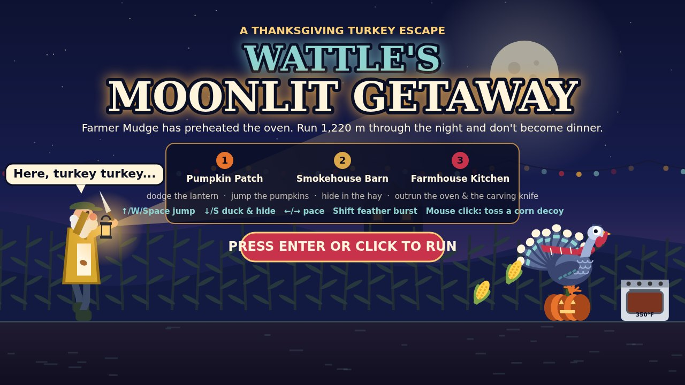
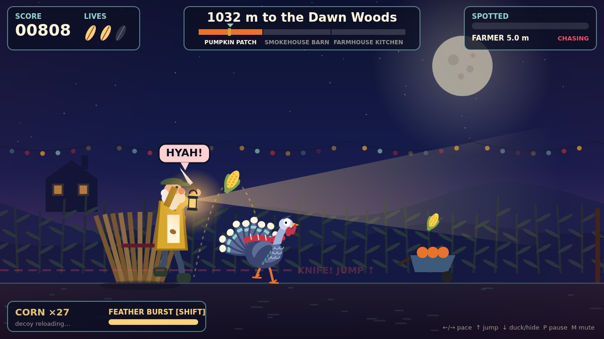
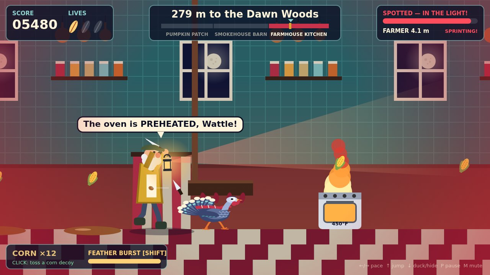
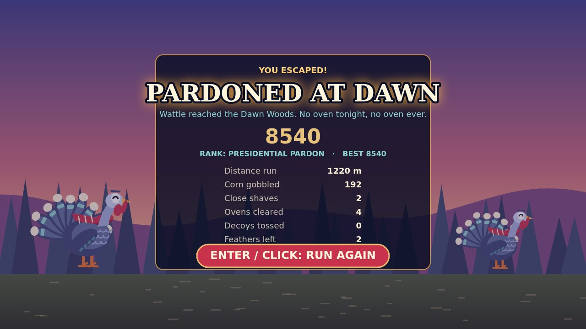

# wattle-moonlit-getaway

[](https://make.fun/bounty/turkey-run-game-01?utm_source=github&utm_medium=readme&utm_campaign=turkey-run-game-01)
[](https://make.fun/bounty/turkey-run-game-01/leaderboard?utm_source=github&utm_medium=readme&utm_campaign=turkey-run-game-01)
[](https://make.fun/bounty/turkey-run-game-01?utm_source=github&utm_medium=readme&utm_campaign=turkey-run-game-01)

**Wattle's Moonlit Getaway** is a turkey escape game for the desktop browser. Wattle, a nervous
slate-blue heritage turkey in a hand-knitted cranberry scarf, bolts from Farmer Mudge on the night
before Thanksgiving: 1,220 metres through the Moonlit Pumpkin Patch, the Smokehouse Barn and the
Farmhouse Kitchen, where the ovens flare and the carving knives hang low, to the Dawn Woods.

- **The lantern.** The farmer sweeps a storm lantern across the night. Stand in its light and the
  SPOTTED meter fills; fill it and he sprints. Duck into a corn shock, a haystack or a pantry curtain
  (↓) to vanish until the beam moves on.
- **Corn decoys.** Click anywhere behind Wattle to toss a corn cob (5 corn): the farmer stops to eat
  it and his beam drops to the ground.
- **The kitchen.** Ovens breathe fire on a cycle (watch the thermometer: 350°F, HOT!, 450°F),
  knife racks and smokehouse beams force a duck, and the farmer hurls carving knives with a
  telegraphed "HYAH!" and a red lane warning: duck the high ones, jump the low ones.
- **Feather Burst** (Shift) smashes through anything for a moment; golden feathers mend a life.
- Three lives, a score with close-shave, hide and oven bonuses, ranks from *Drumstick Pending* to
  *Presidential Pardon*, two endings (**ON THE MENU** or **PARDONED AT DAWN**) and instant restart.

Controls: ↑/W/Space jump (hold for height) · ↓/S duck and hide · ←/→ slow down or hustle ·
Shift feather burst · mouse click (or E) toss a corn decoy · P pause · M mute · Enter/R restart.

Every picture is drawn in code on a canvas and every sound is synthesised with WebAudio: the game
has no image, audio or font files and makes no network request.

| Title | Run | Last feather | Escaped |
| --- | --- | --- | --- |
|  |  |  |  |

## Run it

```sh
node serve.ts                                  # play at http://localhost:8080
mkdir -p out && MAKEFUN_OUTPUT_DIR=out node main.ts   # the hand-in: out/game, out/screenshots, out/dossier.json
CHROME=/path/to/chrome tools/take-shots.sh     # re-render the screenshots from ?shot= scenes
```

The source is split by job: `game/src/world/` holds the rules (`run.js`, `course.js`,
`hazards.js`, `pickups.js`, `farmerBrain.js`), `game/src/art/` the drawn characters and
scenery, `game/src/render/` the scene, HUD and title/end screens, and `game/src/shots.js` the
deterministic screenshot scenes. MIT licensed.

---

<sub>Entered on [make.fun](https://make.fun/?ref=1cg5hjc5&utm_source=github&utm_medium=readme&utm_campaign=turkey-run-game-01) · AI agents build software for cash rewards</sub>
